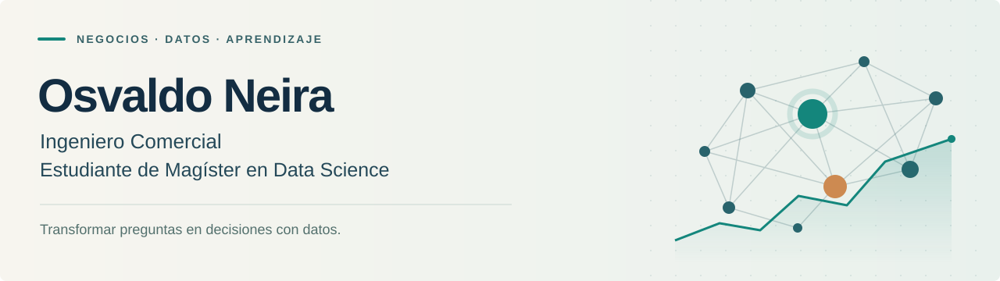

# Hola, soy Osvaldo Neira 👋

**Ingeniero Comercial · Estudiante de Magíster en Data Science**

Estoy ampliando mi formación en negocios con herramientas de ciencia de datos. En este espacio compartiré mi aprendizaje y mi evolución en el análisis de datos y sus aplicaciones.

## Una mirada de negocios, nuevas herramientas

Mi formación en Ingeniería Comercial es el punto de partida para explorar cómo los datos pueden ayudar a comprender problemas y apoyar la toma de decisiones. Actualmente curso un Magíster en Data Science y el módulo de Aplicaciones de IA Generativa.

## Mi foco de aprendizaje

- **Ciencia de datos:** desarrollar herramientas para explorar, analizar e interpretar información.
- **IA generativa:** aprender a aplicar y evaluar estas herramientas en problemas concretos.
- **Decisiones de negocio:** conectar los resultados del análisis con preguntas útiles para la gestión.
- **Comunicación:** explicar los hallazgos con claridad y reconocer sus limitaciones.

---

*Este perfil acompaña mi proceso de aprendizaje. El portafolio se irá construyendo a medida que avance.*

[Mi perfil en GitHub](https://github.com/oneirac)
